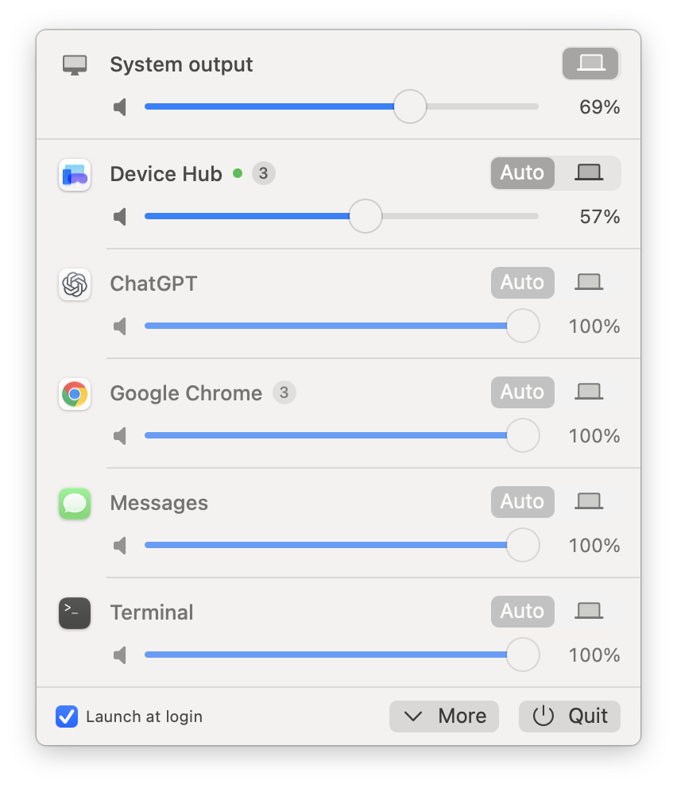

# SoundRouter

*English · [繁體中文](README.zh-TW.md)*

A per-app audio router for macOS: send individual apps to different output devices, each with its own volume and mute. Covers the core of what SoundSource does.

> No prebuilt binaries are provided. Clone and build it yourself — a proper `.app` bundle is a hard requirement for getting the audio-capture permission (see [Permissions](#permissions)).

## Requirements

- **macOS 15 or later** (Core Audio process taps exist since 14.2, but this project targets 15)
- Xcode or the Command Line Tools (Swift 6)
- `build-app.sh` produces a universal binary (arm64 + x86_64). Developed and tested on
  Apple Silicon running macOS 26 — Intel builds, but has not been run there.

## How it works

macOS 14.4 opened up **Core Audio process taps**, so per-app routing needs no driver and no kext. One route is built from three pieces:

1. `AudioHardwareCreateProcessTap` creates a tap on the target process, with `muteBehavior = .muted` so the process no longer reaches its normal output path;
2. a **private aggregate device** is created whose members are the target output device plus that tap;
3. an `AudioDeviceIOProc` on the aggregate copies the tap's input buffer into the output buffer, applying volume and balance.

Capture and playback happen inside the same IOProc, so both sides share a clock. Sample-rate differences are handled by the tap's drift compensation.

## Build

```bash
./Packaging/build-app.sh
```

Output:

| Path | What it is |
| --- | --- |
| `build/SoundRouter.app` | The menu bar app — the main artifact |
| `build/AudioRouterProbe.app` | The CLI wrapped in a bundle, for diagnostics |
| `.build/.../audiorouter` | The bare CLI |

No external dependencies; builds offline.

Run the tests with `swift test`. They cover the pure logic only — see [Testing](#testing).

## Permissions

Process taps require the system audio-capture permission. **Without it a tap does not fail — it silently returns zeroes.** This is the easiest trap to fall into with this API: the symptom is simply that the routed app goes quiet. Check the permission first when debugging.

Getting the permission requires bundle identity — an Info.plist with `NSAudioCaptureUsageDescription`, plus a code signature:

- **`SoundRouter.app`**: macOS prompts the first time a route is created. Allow it. You can revisit the setting under System Settings → Privacy & Security → Screen & System Audio Recording.
- **The bare CLI**: run from a terminal, TCC attributes the request to the terminal app itself, so that terminal has to be in the list above. Invoking it from somewhere else (an editor's built-in terminal, for instance) usually will not get the permission.
- **`AudioRouterProbe.app`**: the same CLI inside an `.app`, so launching it with `open` gives it its own bundle identity:

  ```bash
  open -n -a "$PWD/build/AudioRouterProbe.app" --args \
    --log /tmp/probe.log route Spotify --to "External Speakers" --meter --debug --seconds 10
  ```

Builds are ad-hoc signed, so the signature hash changes every time you rebuild and **the permission may have to be granted again**. To avoid that, create a self-signed code-signing certificate in Keychain Access and build with `CODESIGN_IDENTITY="Your Certificate" ./Packaging/build-app.sh`.

## Interface

Click the menu bar icon (a square speaker cabinet):



> The interface follows your system language: English, or Traditional Chinese. Any other language falls back to English.

- **System output** (top row): the default output device, plus a **master volume** slider and mute button. This is the device's own hardware volume, the same one the keyboard volume keys change, and the slider follows those keys. Devices without software volume control (some HDMI displays) show a note instead.
- **Output device**: a segmented control, one segment per device. "Auto" leaves the app alone and lets it follow the system output. Segments show a device icon chosen by transport type — hover for the name.
- **Volume**: a standard continuous slider, capped at 100%. There is deliberately no gain boost — see [Why 100% is the ceiling](#why-100-is-the-ceiling).
- **Green dot**: the app is currently producing audio.
- **Number badge**: how many audio-producing processes the app has (see below).
- **"Not running" badge**: the app has a saved route but is not currently running. The setting is kept and reapplied when it comes back.
- **Red triangle / info circle / spinner**: the route failed (hover for the message); its device is offline and audio is temporarily following the system; or its engine is still being set up.
- **Right-click a row** for "Reset this app" and, for apps that are not running, "Forget this setting".
- **More / Quit**, bottom right: More shows or hides the "Other processes" section (see below); Quit exits and restores every app's normal output.
- **"Launch at login" checkbox** at the bottom: registers the app as a login item via `SMAppService`. The registration records the app's current location, so install the app in `/Applications` first — enabling it on the copy in `build/` stops working the next time you rebuild, because the build script deletes and recreates that bundle.

The system output row at the top uses the same layout as the app rows, because it is the same kind of thing — a playback target with a set of output choices.

It is the global default device, and only affects apps you have not configured individually.

## Playback source grouping

The list shows **every playback source**, not just the ones currently making noise — in practice you configure things before you play them.

Each row is one app as a user thinks of it, with all of its audio-producing processes folded in:

```
LINE
  ↳ LINE                    pid 5756
  ↳ LINE.MediaService       pid 5762
  ↳ LINE.AudioService       pid 5767      ← this is the one actually making sound
  …
```

This is not cosmetic — it is a correctness requirement. Browsers, Slack and LINE emit audio from separate helper processes or XPC services, so tapping only the main process captures nothing at all. Grouping makes one route cover the whole set.

Ownership is resolved from the **executable path**: helpers and XPC services live inside their app's bundle (`/Applications/LINE.app/Contents/XPCServices/LINE.AudioService.xpc/…`), so the outermost `.app` on the path is the owner. The parent-process chain is deliberately *not* the primary method: XPC services are spawned by launchd, so their parent is launchd rather than the app — and the XPC service is often the one actually making sound. The parent chain is only a fallback.

Two exceptions to "outermost `.app`": an `.app` that sits directly in an `Applications` folder inside another app is a standalone app, not a helper. Xcode ships Device Hub in `Xcode.app/Contents/Applications/` and Simulator in `Xcode.app/Contents/Developer/Applications/`; both get their own row instead of being filed under Xcode.

The main list shows **applications only** — processes whose bundle is running as a regular app with a Dock icon. Everything else (CoreSpeech, audiomxd, Control Center, audio-driver daemons such as `arkaudiod`…) goes into an **Other processes** section that appears when you press **More**; there are usually a couple of dozen of them and they would drown out the real apps. A route you set on one of them keeps working while the section is collapsed. SoundRouter's own process is never listed, since routing it would tap its own output back into itself.

### Device Hub and the simulator

Xcode's Device Hub makes almost no sound itself. Its audio is played by shared system services, which are folded into the Device Hub row while Device Hub is running:

| Source | Process that actually plays it |
| --- | --- |
| Simulator | `SimAudioProcessorService` (CoreSimulator). Claimed by Device Hub, or by Simulator.app when Device Hub is not running |
| Mirrored physical iPhone/iPad | `/usr/libexec/avconferenced`. Claimed by Device Hub, or by FaceTime when Device Hub is not running |

Neither lives in an app bundle and both are launched by launchd, so path and parent-chain attribution cannot find them; without this, tapping Device Hub captures nothing.

**Limitation:** `avconferenced` also carries FaceTime, Continuity Camera and SharePlay audio. They are mixed in the same process and sent to the same output device as the mirrored device, so no tap can tell them apart. **While Device Hub is running, a FaceTime call follows Device Hub's volume**, and the FaceTime row has no effect, because FaceTime.app itself plays nothing. Closing Device Hub's window is not enough; quit it (⌘Q) and the call moves to the FaceTime row. (Splitting `avconferenced` off while its microphone is in use was tried and reverted: during a call Device Hub could then not be turned down at all.)

Known gap: shared system XPC services — WebKit's GPU process, which shows up as something like "LINE Graphics and Media" — live inside a framework rather than an app bundle, so they cannot be attributed and appear separately under Other processes.

## CLI

```bash
audiorouter devices                          # list audio devices
audiorouter apps                             # list playback sources (grouped)
audiorouter apps --system                    # include system processes
audiorouter apps --raw                       # ungrouped process list, for debugging
audiorouter route Spotify --to "Speakers"    # route (runs in the foreground, Ctrl-C restores)
audiorouter route Spotify --volume 0.4       # volume only, output stays on the system default
audiorouter default-output "Speakers"        # change the system default output
audiorouter volume 0.6                       # set the current output device's volume
audiorouter listen "MacBook Pro Microphone"  # watch an input device's levels
```

Options for `route`:

| Option | Meaning |
| --- | --- |
| `--to <device>` | Target output device; the name is matched loosely |
| `--volume <0-1>` | Volume multiplier, 1 is unchanged |
| `--balance <-1-1>` | Stereo balance |
| `--mute` | Mute |
| `--keep-original` | Do not mute the source app's normal output — lets you measure a tap without interrupting playback |
| `--meter` | Continuously print left/right levels |
| `--debug` | Print tap format, buffer layout and IOProc statistics |
| `--seconds <n>` | Run for n seconds, then restore |
| `--log <path>` | Redirect output to a file |

Both the tap and the aggregate device belong to the calling process and are destroyed when it exits, which is why `route` stays in the foreground.

## Persistence

Settings live in `~/Library/Application Support/SoundRouter/routes.json`, keyed by bundle ID. They survive quitting the app and restarting the routed app. Entries that return to their defaults are removed from the file.

**If a route's output device is gone, the route resets to following the system output** and the device is forgotten. Keeping a UID that can no longer be resolved would leave the UI offering a device you cannot pick, and would move audio without warning the moment the device reappeared. The cost is that a *temporary* disappearance also discards the setting — a display going to sleep takes its HDMI audio device with it, for example.

## Diagnostics

A menu bar app has no stdout, so every refresh overwrites `~/Library/Logs/SoundRouter-status.txt` with the current state:

- devices found, and which are the current defaults
- every playback source, its process count, and whether it is playing
- how many rows the list is showing, and how many playback-state listeners are installed
- each active route: target device, volume, and whether its engine is running, still starting, or failed with an error

When the UI looks wrong, read this first — it separates "the data is wrong" from "the layout is wrong". The route section is also the quickest way to tell a route that is genuinely stuck from one that is simply still being set up, since building an engine talks to `coreaudiod` and is not always instant.

## Testing

```bash
swift test
```

The suite deliberately covers **only logic that needs no audio hardware** — mainly the grouping rules, which decide whether routing an app actually captures its sound, and which are pure data transformation. Taps and aggregate devices are not tested: they need real devices and a granted TCC permission, so testing them in CI would only produce a false green.

## Project layout

```
Sources/AudioRouterCore/
  CoreAudioSupport.swift   Generic Core Audio property access, error conversion
  AudioDevice.swift        Device enumeration, default devices, hardware volume
  AudioProcess.swift       Audio process enumeration and grouping by app
  RouteEngine.swift        tap + aggregate + IOProc — the core of one route
  RouterManager.swift      Owns all routes, tracks system changes, loads/saves settings
  InputMonitor.swift       Input device level monitoring (the CLI's listen command)
Sources/audiorouter/       CLI
Sources/SoundRouterApp/    SwiftUI menu bar app
Tests/                     Unit tests for the hardware-independent logic
Packaging/                 build-app.sh, Info.plists, AppIcon.icns and make-icon.swift (redraws the icon)
```

## Why 100% is the ceiling

Volume is a gain multiplier, and boosting past 1.0 pushes samples beyond ±1.0, where they get hard-clipped downstream by whatever device driver receives them. Rather than hand users a control that quietly distorts, the ceiling is 100%. The render path still clamps to ±1.0 as a safety net.

## Gotchas worth knowing about

**An unauthorized tap is silent, not an error.** The first version created taps fine, ran its IOProc 86 times a second, had a correct buffer layout — and every sample was zero. A bare executable has no bundle identity, so the system never even shows the permission prompt.

**`try?` can infer a generic as Optional.** In `guard let id: AudioObjectID = try? obj.read(sel)`, `T` may be inferred as `Optional<UInt32>` — `try?` flattens nested optionals, so both inferences type-check. The Optional version computes a size one tag byte too large, Core Audio returns `kAudioHardwareBadPropertySizeError`, and `try?` swallows it into `nil`. Silent the whole way through. Every call site now names its type explicitly with `as: X.self`, and `read` rejects Optional types and asserts in debug builds.

**`ScrollView` has no intrinsic height inside `MenuBarExtra`.** The window sizes itself to its content, and a ScrollView's ideal height is 0: `maxHeight` alone collapses it to nothing, `minHeight` alone pins it and truncates the list, and measuring the content with `GeometryReader` reports 0 in this environment. The working approach is not to measure at all — estimate row height times row count, and skip the ScrollView entirely when everything fits (see `FittingList`).

**Core Audio setup calls can block indefinitely — never make them on the main thread.** `AudioDeviceCreateIOProcIDWithBlock` does synchronous IPC to `coreaudiod`, and while a USB device is re-enumerating that call can simply not return. Called from the main thread it freezes the entire UI, including the menu bar panel, leaving force-quit as the only way out. Engine startup therefore runs on a background task and reports back to the main actor.

**The HAL never notifies `kAudioProcessPropertyIsRunningOutput`.** Registering a listener on it succeeds and then never fires. A wildcard listener reveals that macOS only sends notifications for `IsRunning` and `Devices`. Listen on `IsRunning`, then re-read `IsRunningOutput` for the actual state.

**The `MenuBarExtra` window grows but never shrinks.** Expand a long list and collapse it again, and the window keeps its taller size with the content centred in it, leaving translucent empty bands above and below. The panel pins its height to its content (`fixedSize`), measures it, and resizes the window itself, keeping the top edge under the menu bar (`WindowHeightSync` in `RouterPanel.swift`).

## Not covered

- **Localization is only partial**: the menu bar interface is localized (English and Traditional Chinese), and Core Audio error messages and permission prompts are in English, but all CLI output and the diagnostic file are still Traditional Chinese only.
- **EQ and AudioUnit effect chains**: `RouteEngine.render` only does volume and balance. Effects would hook in just before writing the output buffer.
- **Splitting one app across multiple output devices**: one route targets one device.
- **AirPlay**: AirPlay targets do appear as Core Audio devices and will show up in the dropdown, but whether one can serve as an aggregate sub-device is untested — network clocking makes it doubtful.
- Sample-rate differences are left to the aggregate's drift compensation (a 48 kHz tap into a 44.1 kHz output works in practice). If you hear artefacts or wrong pitch on some device, matching the rates rules this out.

## Contributing

See [CONTRIBUTING.md](CONTRIBUTING.md). The short version: if a routed app goes silent, check the audio-capture permission before assuming you broke something.

## License

MIT — see [LICENSE](LICENSE).
